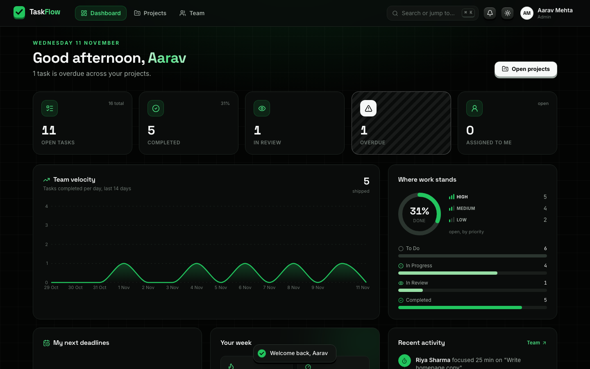
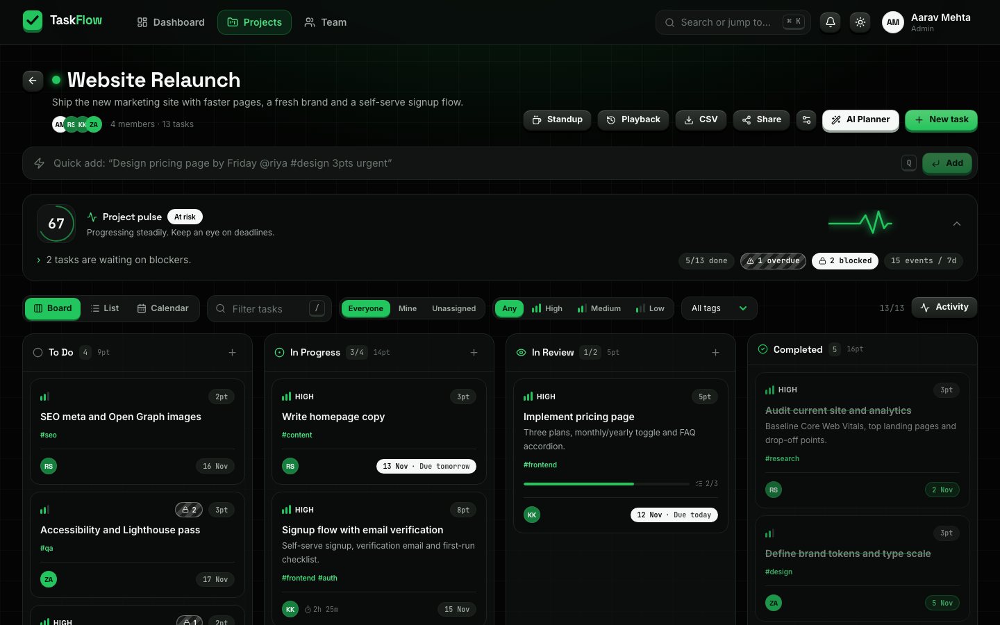
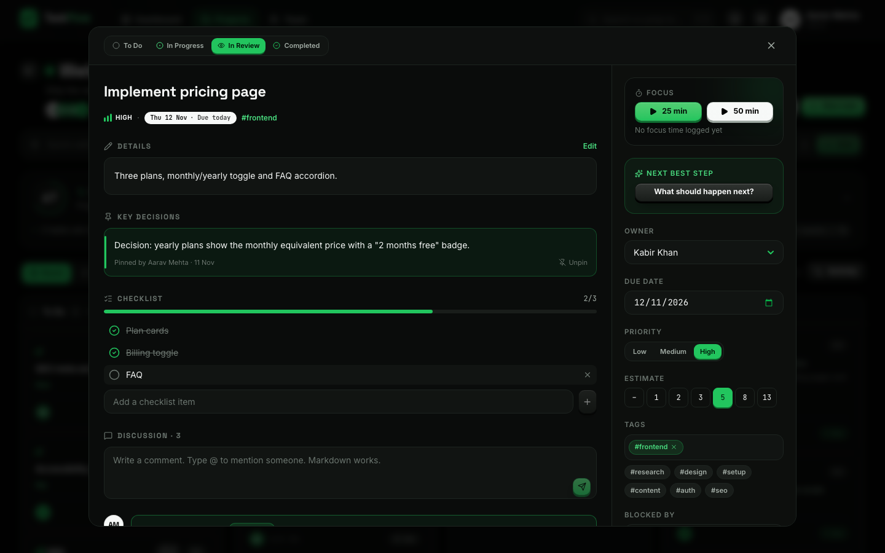
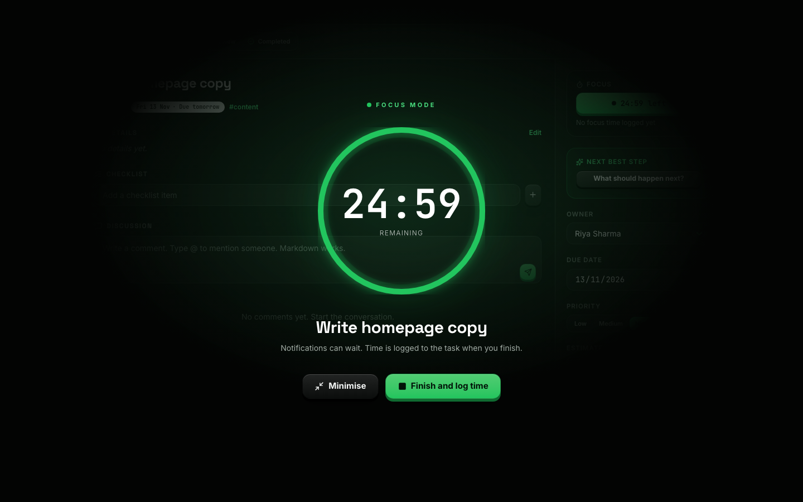
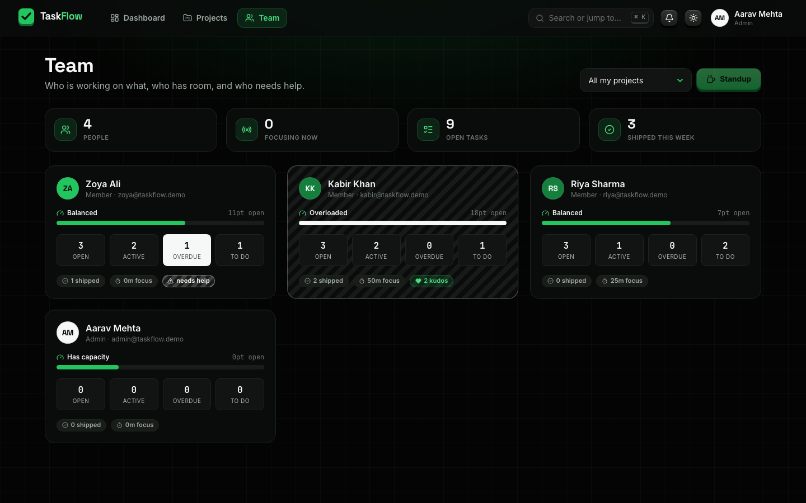
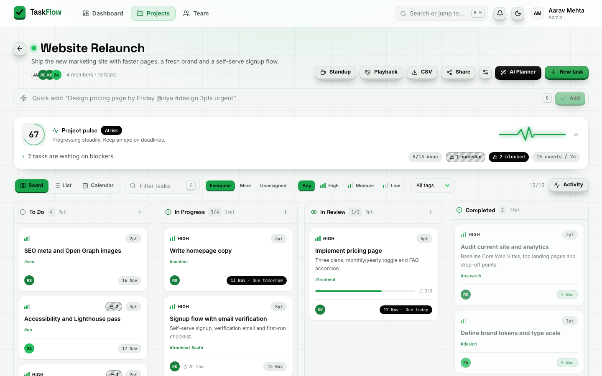
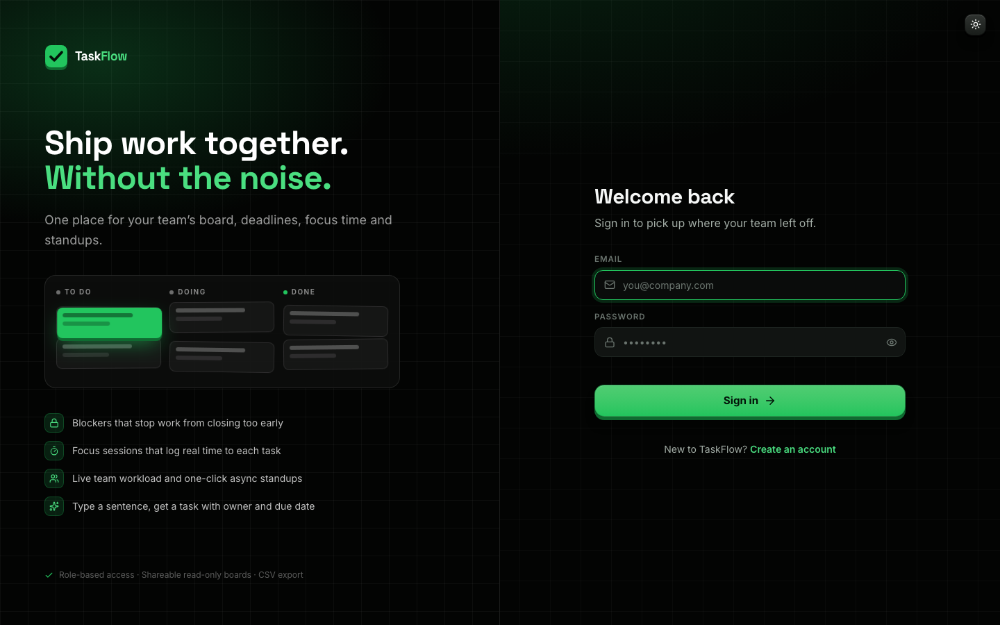

# TaskFlow — Team Task Manager

A full-stack team task manager for small teams that want more than a to-do list: a Kanban board with **WIP limits and blockers**, **Focus Mode** that logs real time to tasks, a **live team workload** view, **one-click async standups**, **@mentions with an inbox**, and **AI planning** that still works with no AI keys at all.

Black, green and white UI with 3D press buttons, tilt cards, page transitions and a circular theme reveal. Dark and light themes.

**Live app:** [taskflow-app-five-inky.vercel.app](https://taskflow-app-five-inky.vercel.app) · demo login `riya@taskflow.demo` / `demo1234`



---

## What makes it different

| Feature | What it does |
|---|---|
| **Blockers / dependencies** | Mark a task as waiting on other tasks. Blocked cards show a lock, and the API refuses to complete a task while its blockers are open. Dependency cycles are rejected. |
| **WIP limits** | Per-column work-in-progress limits (To Do, In Progress, In Review). Columns over the limit get a striped warning so the team finishes before starting more. |
| **Focus Mode** | Start a 25 or 50 minute session from any task. A full-screen timer (or a floating pill) counts down, then the time is logged to the task and to the activity feed. Starting focus on a To Do task moves it to In Progress. |
| **Live team workload** | The Team page shows open work, overdue tasks, story points, weekly output, kudos and focus minutes for each person, flags overloaded people, and shows who is focusing right now. |
| **Async standups** | Generates Done / Doing / Blockers for each member from the board and the activity log (24h, 3 days or a week) and copies it as Markdown for Slack or email. |
| **Quick Add** | Type `Design pricing page by Friday @riya #design 3pts urgent` and get a task with title, owner, due date (in your timezone), tag, estimate and priority. Works offline with a built-in parser; Groq, Gemini or OpenRouter refine it when keys are set. |
| **AI Planner** | Describe a goal and review a full plan (tasks, estimates, checklists, due dates) before anything is created. Falls back to built-in playbooks when no AI provider is configured. |
| **@mentions and inbox** | Mention teammates in comments (with autocomplete). Mentions, assignments, status changes on your tasks and kudos land in a notification inbox that links straight to the task. |
| **Kudos** | Thank the owner of a completed task. Kudos show on the card and on the Team page. |
| **Three views** | Board (drag and drop, keyboard accessible), sortable List, and a month Calendar. |
| **Project pulse** | A 0–100 health score from completion, overdue work, blockers, review bottlenecks and activity, with burnout warnings. |
| **Ghost playback** | Replay the project history event by event, with a scrubber, 1x/2x/4x speed and highlights. |
| **Decision log** | Pin any comment as a key decision so it sits at the top of the task. |
| **Public share links** | Read-only board for clients or reviewers. No emails, comments or time logs are exposed, and links can be revoked. |
| **Command palette and shortcuts** | `Ctrl/⌘ K` searches tasks, projects and commands. `G D` / `G P` / `G T` navigate, `N` new task, `Q` quick add, `/` filter, `1` `2` `3` switch views, `?` shows every shortcut. |

<table>
<tr>
<td></td>
<td></td>
</tr>
<tr>
<td></td>
<td></td>
</tr>
<tr>
<td></td>
<td></td>
</tr>
</table>

## Roles

| | Admin | Member |
|---|---|---|
| See projects | All projects | Projects they belong to |
| Create, edit, delete projects and tasks | Yes | No |
| Move tasks, tick checklists, comment, focus, kudos | Yes | Yes, in their projects |
| Quick Add and AI Planner | Yes | No |
| Pin decisions, manage share links | Yes | No |

Every project, task, comment, activity, pulse, playback and standup endpoint checks project membership on the server, not just in the UI.

## Tech stack

| Layer | Technology |
|---|---|
| Frontend | React 19, Vite 8, Tailwind CSS 4, Framer Motion, Recharts, @hello-pangea/dnd, react-markdown, Lucide |
| Backend | Node.js 20+, Express 5, Mongoose 9 |
| Database | MongoDB |
| Auth | JWT (7 days) + bcrypt (12 rounds), rate-limited sign in and sign up |
| AI (optional) | Groq, Google Gemini, OpenRouter, tried in that order |
| Tests | `node:test` unit tests plus an end-to-end API test against a real MongoDB |

## Getting started

Prerequisites: Node.js 20 or newer and MongoDB. Locally the API uses `mongodb://127.0.0.1:27017/taskflow` when `MONGO_URI` is not set, so a running local MongoDB (for example `brew services start mongodb-community`) is all you need.

```bash
git clone https://github.com/AnshumaanSinghh/team-task-manager.git
cd team-task-manager
npm install
npm run install:all
npm run seed      # optional demo data
npm run dev
```

- App: http://localhost:3000 (the dev server proxies `/api` to the API, no frontend config needed)
- API: http://localhost:5000, health check at http://localhost:5000/api/health

Demo sign-ins after seeding (password `demo1234`): `admin@taskflow.demo` (Admin), `riya@taskflow.demo`, `kabir@taskflow.demo`, `zoya@taskflow.demo` (Members).

To use MongoDB Atlas or a different database locally, copy `backend/.env.example` to `backend/.env` and set `MONGO_URI`.

### Environment variables (backend)

| Variable | Required | Notes |
|---|---|---|
| `MONGO_URI` | In production | MongoDB connection string. `MONGODB_URI` (set by the Vercel Marketplace Atlas integration) also works. Defaults to local MongoDB in development. |
| `JWT_SECRET` | In production | Long random string (`openssl rand -hex 32`). Without it a production API answers every request with a clear 503. |
| `NODE_ENV` | No | Set `production` on your host |
| `PORT` | No | Default `5000` |
| `CORS_ORIGINS` | No | Comma-separated allowed origins. Default allows all. |
| `GROQ_API_KEY`, `GEMINI_API_KEY`, `OPENROUTER_API_KEY` | No | Enable AI refinement for Quick Add and the AI Planner |
| `GROQ_MODEL`, `GEMINI_MODEL`, `OPENROUTER_MODEL` | No | Override the default model for each provider |

The frontend needs no variables: it calls `/api` on its own origin. Set `VITE_API_URL` only if you want the browser to call an API on another domain directly.

Secrets belong in your host's environment settings or a local `.env`, never in the repository.

## Scripts

| Command | What it does |
|---|---|
| `npm run dev` | API and frontend together |
| `npm test` | Backend unit tests, plus the API end-to-end test when `TEST_MONGO_URI` is set |
| `npm run lint` | ESLint for the frontend |
| `npm run build` | Production build of the frontend |
| `npm run seed` | Demo data (refuses to run with `NODE_ENV=production` unless `--yes` is passed) |

Run the full API test against a throwaway database (it is dropped afterwards):

```bash
TEST_MONGO_URI=mongodb://127.0.0.1:27017/taskflow_test npm test
```

## API overview

All routes are under `/api`. Everything except sign up, sign in, health and public boards needs `Authorization: Bearer <token>`.

**Auth** · `POST /auth/signup` · `POST /auth/login` · `GET /auth/me` · `GET /auth/users`

**Projects** · `GET /projects` (with task stats) · `POST /projects` · `GET/PUT/DELETE /projects/:id` · `GET /projects/:id/activity` · `GET /projects/:id/pulse` · `GET /projects/:id/playback-highlights` · `GET /projects/:id/standup?hours=24` · `POST/DELETE /projects/:id/share` · `GET /projects/public/:shareId`

**Tasks** · `GET /tasks?projectId&status&priority&search&assignee=me&tag` · `POST /tasks` · `PUT/DELETE /tasks/:id` · `GET /tasks/dashboard?tz=` · `POST /tasks/ai-create` · `POST /tasks/ai-plan` · `POST /tasks/bulk` · `GET/POST /tasks/:id/comments` · `DELETE /tasks/:id/comments/:commentId` · `PUT /tasks/:id/comments/:commentId/decision` · `GET /tasks/:id/suggest-next-step` · `POST /tasks/:id/kudos` · `POST /tasks/:id/focus` · `POST /tasks/focus/stop`

**Team** · `GET /team/workload?projectId=`

**Notifications** · `GET /notifications` · `PUT /notifications/read-all` · `PUT /notifications/:id/read`

## Project structure

```
team-task-manager/
├── backend/
│   ├── controllers/     auth, project, task, team, notification
│   ├── lib/             access control, quick-add parser, AI providers, planner,
│   │                    pulse score, standup builder, mentions, rate limiter
│   ├── models/          User, Project, Task, Comment, Activity, Notification
│   ├── routes/
│   ├── scripts/seed.js
│   ├── test/            unit tests + end-to-end API test
│   └── server.js
├── frontend/
│   └── src/
│       ├── components/  board (Kanban, list, calendar), modals, palette, focus overlay, ui kit
│       ├── context/     auth, theme, focus session
│       ├── lib/         formatting, hotkeys, confetti
│       └── pages/       Dashboard, Projects, ProjectDetails, Team, PublicProject, Login, Signup
└── docs/screenshots/
```

## Deployment (Vercel + MongoDB Atlas)

Deploy as two Vercel projects from this repo: the API first, because the frontend needs its domain.

1. **API project.** *Add New → Project*, import this repo, set the root directory to `backend` (it uses `backend/vercel.json`). Add the environment variables `JWT_SECRET` (output of `openssl rand -hex 32`) and `NODE_ENV=production`, then deploy.
2. **Database.** Either:
   - **From Vercel:** in the API project open *Storage → Create Database → MongoDB Atlas*, choose the free tier and connect it to the project. It adds `MONGODB_URI`, which the API reads when `MONGO_URI` is not set. Redeploy the API so it picks up the variable.
   - **From Atlas directly:** at [cloud.mongodb.com](https://cloud.mongodb.com) create a free M0 cluster. Under *Database Access* add a user; under *Network Access* allow `0.0.0.0/0` (serverless functions have no fixed IP). Copy the connection string from *Connect → Drivers*, add a database name (`...mongodb.net/taskflow?retryWrites=true&w=majority`), save it as `MONGO_URI` in the API project and redeploy.

   Open `https://<api-domain>/api/health`: it should say `"database": "connected"` and `"jwtSecret": "set"`.
3. **Frontend project.** Import the repo again, root directory `frontend`, framework preset Vite. Point it at the API in one of two ways:
   - set `VITE_API_URL=https://<api-domain>/api` in the frontend project's environment variables before deploying (no code change; the API allows any origin unless `CORS_ORIGINS` is set), or
   - change the domain in the `/api/*` rewrite in `frontend/vercel.json` to your API domain and push. This keeps API calls same-origin.

   If you change `VITE_API_URL` later, redeploy the frontend: Vite bakes it in at build time.
4. **Demo data (optional).** `NODE_ENV=production MONGO_URI="<connection string>" npm run seed --prefix backend -- --yes` adds a demo team, with members such as `riya@taskflow.demo` / `demo1234`.

Railway or Render work the same way for the API: root directory `backend`, start command `node server.js`, same variables.

## Troubleshooting sign in / sign up

The sign-in and sign-up pages check `/api/health` and show what is wrong. Common cases:

| Message | Fix |
|---|---|
| *Cannot reach the TaskFlow server* | The API is not running or the frontend points at the wrong domain. Locally run `npm run dev`; on Vercel check the rewrite in `frontend/vercel.json`, or `VITE_API_URL` if you set it. |
| *MongoDB host not found* | The Atlas cluster was deleted or paused, or `MONGO_URI` / `MONGODB_URI` has a typo. Create or resume the cluster and update the variable. |
| *Could not reach MongoDB in time* | Allow `0.0.0.0/0` in Atlas *Network Access*. |
| *MongoDB rejected the username or password* | Fix the user or password in `MONGO_URI` (URL-encode special characters). |
| *Set JWT_SECRET* | Add `JWT_SECRET` to the API environment and redeploy. |
| *Too many attempts* | 20 failed sign-in or sign-up attempts from one network in 15 minutes. Wait, then try again. Successful sign-ins never count. |

## Author

Built by **Anshumaan Singh** · [github.com/AnshumaanSinghh](https://github.com/AnshumaanSinghh)
